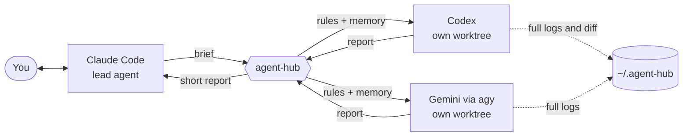

<div align="center">

# agent-hub

**One conversation. Three AI subscriptions. Claude stays in charge.**

A Claude Code skill that hands reading-heavy work to Codex and Gemini, each in its own isolated workspace, and brings back only a short report.

[](LICENSE)


[Quick start](#quick-start) · [How it works](#how-it-works) · [Configuration](#configuration) · [Safety](#safety)

</div>

---

## Why agent-hub?

You pay for Claude, ChatGPT and Google AI, but your Claude limit runs out first while the others sit idle. Sending a command to another CLI is easy. Making that useful is not: the agent has no project context, it works in your live checkout, it forgets everything between calls, and its long output lands back in Claude's context.

agent-hub fixes those four problems and nothing else.

| Without agent-hub | With agent-hub |
|---|---|
| Agents run in your working copy | Each agent has a private git worktree |
| Every call starts with no context | Project rules and memory are added automatically |
| Each call forgets the last one | `resume` continues the same session, workspace and branch |
| Long output fills Claude's context | Claude reads a report of at most 40 lines; logs stay on disk |
| Nothing to look back at | Every task keeps its brief, report, logs and diff |

You never leave your Claude conversation. Claude decides when to delegate, checks the result, and tells you what matters.

## How it works



1. You ask Claude for something, as usual.
2. Claude keeps the job, or writes a brief for another agent.
3. The hub syncs that agent's workspace to your commit and adds your project context.
4. The agent works and ends with a fixed-format report.
5. Claude checks the findings against the code and answers you.

**Who does what by default**

| Agent | Best used for | Access |
|---|---|---|
| **Claude** | Writing code, decisions, final review | Your project |
| **Codex** | Code review, hard reasoning, second opinions, large mechanical edits | Read-only, or its own `agent/` branch |
| **Gemini** | Large code investigation, research, independent analysis | Read-only, always |

## Quick start

**1. Install the agents you want.** One is enough.

- [Codex CLI](https://github.com/openai/codex), signed in
- [Antigravity CLI](https://antigravity.google/docs/cli) (`agy`), signed in once by running `agy`

> Google closed Gemini CLI to personal accounts in June 2026. The `gemini` agent here runs through `agy`, which uses your Google subscription.

**2. Install the skill.** You need Python 3.9+, git and [Claude Code](https://claude.com/claude-code).

```bash
git clone https://github.com/canxsrky/agent-hub ~/.claude/skills/agent-hub
python ~/.claude/skills/agent-hub/test_hub.py
```

**3. Start a new Claude Code session and just ask.**

> Have Codex review this branch for bugs.

> Ask Gemini to map how authentication works across this repo.

## Configuration

Optional. Without a config, the hub uses the current git repository and each CLI's default model. To customize, copy [`config.example.json`](config.example.json) to `~/.agent-hub/config.json`.

| Key | Meaning |
|---|---|
| `repo` | Project path. Default: the current git repository |
| `project_name` | Shown to the agents |
| `rules_file` | Rules added to every task. Default: `AGENTS.md` |
| `memory` | Folder with a `MEMORY.md` index the agents may read |
| `read_dirs` | Extra folders outside the project that Gemini may read |
| `limits` | Extra hard limits for your project |
| `codex.model`, `codex.effort`, `codex.config` | Codex defaults. `config` holds `-c` overrides |
| `gemini.model`, `gemini.effort` | `agy` defaults. List models with `agy models` |
| `gemini.deny` | Extra `agy` rules, such as `read_file(/path/to/private/)` |

The model is chosen in this order: `--model` on the task, then the config, then the CLI's own default.

## Command line

Claude runs these for you, and you can run them too.

```bash
python hub.py run codex "brief" [--write] [--base <ref>] [--model <m>] [--effort <e>] [--timeout 1800]
python hub.py run gemini --brief-file brief.md
python hub.py resume <task> "follow-up"
python hub.py list
python hub.py show <task>
```

Agents see committed code only, so commit first or pass `--base <branch>`. Each agent runs one task at a time.

## Safety

| Agent | Mode | Enforced by |
|---|---|---|
| Codex | default | Codex `read-only` sandbox |
| Codex | `--write` | Codex `workspace-write` sandbox. Results land on an `agent/codex/<task>` branch for review |
| Gemini | always | `agy` deny rules for writes, commands and secret files, set for that run only |

**Secrets:** Gemini can read your whole project, including git-ignored folders, so you never have to list them. Before each task the hub finds files that look like secrets (`.env`, keys, certificates, `id_rsa`, `db.php`, and names with password, secret, credential or token) and blocks each one by exact path. A secret with an ordinary file name is not detected, so add it to `gemini.deny`.

**What we tested:** Codex shell commands could not write in read-only mode, and could not write outside the workspace in `--write` mode. Gemini could not create files or run commands, and could not read decoy `.env`, `.pem` and password files while it could read an ordinary file next to them.

**What we did not test:** Whether Gemini's search tools respect the secret block; our one attempt was inconclusive. Codex read-only can read the whole disk, including secrets, and its sandbox was not tested against services, databases or network access. The `limits` setting is an instruction to the agent, not enforcement. On a machine that matters, keep reviewing the results.

**Your code goes to these providers.** Check their data terms before you send private code. `agy` can collect interaction data unless you turn it off in `/config`.

## Compatibility

| | |
|---|---|
| Tested on | Windows Server 2025, Codex CLI 0.163, `agy` 1.5.1 |
| Not yet run | macOS and Linux. The code paths exist, and reports are welcome |

On Windows, Codex's sandbox cannot start the Microsoft Store build of PowerShell, so the hub hides it from Codex. Codex then uses another PowerShell.

These CLIs change their flags often, so a newer version may need a small fix. Run `python test_hub.py` after you update, and open an issue if a real task fails.

## Project layout

```
hub.py               the whole tool, standard library only
test_hub.py          checks for outcome logic
SKILL.md             tells Claude when and how to delegate
config.example.json  starting point for your config
```

---

<div align="center">

MIT License · Not affiliated with Anthropic, OpenAI or Google

</div>
